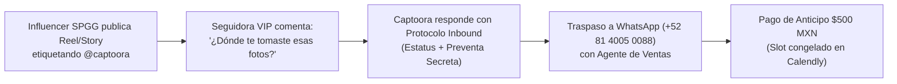

# 👑 ESTRATEGIA INBOUND VIRAL DE ALTO PODER ADQUISITIVO
## SAN PEDRO GARZA GARCÍA & MONTERREY ELITE · CAMPAÑA NAVIDAD 2026
### *Aprovechamiento Orgánico Masivo de los 25 Testimonios de Estudio y 3 Influencers Pesadas de MTY (Cero Gasto en Pauta / Zero Ad Spend)*

**Fecha de Activación:** Semana del 2 al 8 de Noviembre de 2026  
**Locación del Estudio:** Av. Paseo de los Álamos 165, Colinas de San Jerónimo, Monterrey, N.L.  
**Canal de Reserva Inbound:** WhatsApp Business [+52 81 4005 0088](https://wa.me/528140050088)  

---

## 🎯 1. LA PREMISA ESTRATÉGICA: CERO GASTO EN PAUTA (ZERO AD SPEND)

Prescindimos por completo de pagarle a Meta Ads, TikTok Ads, LinkedIn Ads o MercadoLibre. La razón es matemática y orgánica:
1. El 31 de octubre de 2026 se llevó a cabo el magno rodaje en Captoora Studio con **más de 25 creadoras y líderes de negocio**.
2. De ese grupo, **3 son Influencers pesadas de Monterrey y San Pedro Garza García (SPGG)** con comunidades cautivas compuestas exactamente por nuestro cliente ideal: **mujeres regias de alto poder adquisitivo, empresarias, esposas, mamás de colegios privados y familias que marcan tendencia en San Pedro y San Jerónimo**.
3. Durante esta primera semana de noviembre, este grupo de 25 mujeres comenzará a liberar de manera escalonada sus fotos finales, detrás de cámaras (BTS) y videos testimoniales etiquetando a `@captoora` y Alfonso Gutiérrez.
4. **El objetivo:** No venderles de forma invasiva. Las mujeres de San Pedro no compran cuando sienten que les están vendiendo un paquete barato; compran por **deseo proyectado, pertenencia de estatus y validación social**. Ellas van a venir a nosotros.

---

## 🧠 2. ANATOMÍA PSICOLÓGICA DE LA CLIENTA REGIA (SPGG & MONTERREY)

El mercado de San Pedro Garza García es considerado el de mayor PIB per cápita y mayor sofisticación de negociación de América Latina. No compran como en el centro o sur del país:

| Rasgo Psicológico Regio | Cómo Opera su Decisión | Error Común de la Competencia | El Código Captoora (Inbound) |
| :--- | :--- | :--- | :--- |
| **Orgullo & Mente Negociadora** | Odia que le quieran "ver la cara" o que le vendan cosas baratas con empaque caro. Le fascina hacer negocios inteligentes donde sienta que ganó ventaja. | Promociones chafas de "50% de descuento" que abaratan la marca. | **Incentivo Racional:** *"Preventa exclusiva de montaje: apartas con $500, tu sesión cuesta $1,500 en lugar de $2,500"*. Reconoce que ahorrarse $1,000 MXN en una producción de autor con Nikon Z9 es una decisión financiera brillante. |
| **La Matriarca Invisible** | Mamá es quien organiza la casa, la cena, las galas y los colegios, pero en el 95% de las fotos de su celular ella no sale porque ella las toma. O sale cansada. | Anuncios que solo muestran a los niños con juguetes plásticos. | **Inyección Emocional:** *"Mamá este año no toma la foto; mamá es la protagonista del cuadro que se cuelga en la sala"*. |
| **Aversión al Cliché Kitsch** | Rechaza los fondos de vinil arrugados, los gorros de Santa de poliéster y las luces de colores parpadeantes que parecen de tienda de abarrotes. | Decorados saturados y poses tiesas de centro comercial. | **Quiet Luxury:** Terciopelo verde esmeralda, sastrería, mimosas con copa de cristal, sillón boucle nórdico y parque natural anexo al salir del estudio. |
| **Estatus & Efecto Rebaño SPGG** | Si ve que sus 3 amigas influyentes o líderes de su círculo se tomaron fotos espectaculares en un estudio privado con trato VIP y mimosas, necesita reservar su fecha de inmediato para no quedarse fuera. | Esperar a que la gente busque "fotógrafo cerca de mí" en Google. | **Prueba Social en Cascada:** Al ver los 25 testimonios en video con el micrófono Lavalier y las fotos sin marca de agua de las influencers, la validación es instantánea. |

---

## ⚡ 3. LOS 6 GANCHOS PSICOLÓGICOS MAESTROS (INYECCIÓN DE NECESIDAD)

Estos son los copys y ángulos que se detonan orgánicamente en historias, respuestas a las influencers y publicaciones del estudio:

### GANCHO 1 · "EL SÍNDROME DE LA MAMÁ INVISIBLE"
> *"Abre el carrete de tu celular ahorita mismo. Tienes 4,000 fotos de tus hijos, del perro, de las vacaciones y de las comidas familiares. ¿En cuántas sales tú? En casi ninguna. Porque tú fuiste quien sostuvo el teléfono todo el año. Dentro de 20 años, tus hijos no van a buscar fotos de juguetes; van a buscar tus ojos y tu sonrisa abrazándolos. Este año mamá no sostiene la cámara. Mamá es el centro del cuadro oficial de Navidad."*

### GANCHO 2 · "EL VESTIDO DE GALA NO PUEDE MORIR EN UNA SELFIE DE BAÑO"
> *"Gastaste tiempo, dinero y gusto eligiendo tu outfit para la posada o la cena de gala de fin de año. ¿Y cuál va a ser tu recuerdo? ¿Una selfie en el espejo del baño del restaurante con la luz del techo haciéndote ojeras? Hay momentos que merecen copa de champagne en mano, sastrería a medida, fondo de autor y la óptica 100% Full-Frame de una Nikon Z9. Captoora Signature: Navidad Black Tie."*

### GANCHO 3 · "EL TIEMPO NO REGRESA (NO ESPERES AL PRÓXIMO AÑO)"
> *"Tus hijos tienen 3, 6 u 11 años. Es la única vez en toda su vida que van a tener esta edad en Navidad. El próximo año ya cambiaron de dientes, ya se estiraron, ya no quieren ponerse el suéter navideño o ya no creen en la magia de la misma manera. El dinero y los negocios siempre vuelven; la Navidad 2026 de tus hijos jamás. Congela la memoria antes de que el tiempo te gane."*

### GANCHO 4 · "EL TROFEO DE LA MUJER DE NEGOCIOS"
> *"Trabajaste 12 meses como fiera: abriste sucursales, lideraste equipos, superaste metas y mantuviste a tu familia al cien. ¿Cómo vas a cerrar el 2026? ¿Con un flyer prediseñado de internet? Tu presencia, tu rostro y tu equipo merecen una imagen que grite victoria, liderazgo y sofisticación. Sesiones corporativas de fin de año y retrato ejecutivo con factura deducible."*

### GANCHO 5 · "FOTOGRAFÍA SIN CIRCO NI ESTRÉS INFANTIL"
> *"¿Por qué a los niños les choca ir al fotógrafo? Porque los sientan en un banco duro, les apuntan con luces frías y les exigen '¡sonríe a la de tres!'. En Captoora no posan tiesos: juegan, descubren cascanueces de madera real, brincan en el sofá boucle y luego salimos al parque arbolado que tenemos afuera del estudio. Cero gritos, cero lágrimas, puras sonrisas espontáneas."*

### GANCHO 6 · "EL ORGULLO Y LA NEGOCIACIÓN INTELIGENTE"
> *"Los regios no compramos cosas por comprar; invertimos con astucia. Esta semana el set navideño está en calibración y montaje en San Jerónimo. Mientras ajustamos luces, abrimos la preventa flash: apartas tu fecha con solo $500 MXN y tu sesión queda en $1,500 en lugar del precio regular de $2,500. Te llevas la calidad fotográfica más alta de Monterrey y te ahorras $1,000 directos en tu cuenta."*

---

## 🔄 4. EL PUENTE ORGÁNICO VIRAL (DE TESTIMONIO A RESERVA EN WHATSAPP)

### Protocolo de Respuesta en DMs / Comentarios Públicos:
Cuando una seguidora de las influencers comente o envíe DM preguntando por el set o las fotos:

**Mensaje Inbound de Respuesta:**
> *"¡Hola [Nombre]! Qué gusto saludarte. Sí, las fotos de [Nombre de la Influencer] se crearon aquí en Captoora Studio (estamos en San Jerónimo, con parque privado). Justo esta semana estamos terminando el montaje de nuestro Set Navideño 2026 y abrimos una preventa secreta para familias y parejas: apartas tu lugar con solo $500 MXN y te congelamos la tarifa especial de $1,500 (el precio normal es de $2,500). Te paso el enlace directo de WhatsApp para mostrarte los 5 conceptos y que apartes tu día antes de que se llenen los fines de semana: https://wa.me/528140050088?text=Hola%20Captoora%2C%20vi%20las%20fotos%20con%20[Nombre]%20y%20quiero%20informaci%C3%B3n%20de%20la%20preventa%20navide%C3%B1a"*

---

## 📅 5. CALENDARIO DE EXPANSIÓN ORGÁNICA (NOVIEMBRE 2026)

| Día | Pilar de Contenido | Asset Utilizado | Objetivo Inbound |
| :--- | :--- | :--- | :--- |
| **Lunes 02 Nov** | Montaje en Set & Anuncio de Preventa | Video ASMR detrás de cámaras Nikon Z9 + Luces | Generar FOMO y curiosidad inicial en San Jerónimo / SPGG. |
| **Martes 03 Nov** | **Testimonio VIP 01 (Influencer Pesada 1)** | Video Lavalier vertical 9:16 + Galería Full-Frame | Demostración de trato VIP y experiencia de estudio para empresarias. |
| **Miércoles 04 Nov** | Gancho Emocional: "La Mamá Invisible" | Foto familiar en sofá boucle nórdico ([02_navidad_studio_familiar.jpg](file:///Users/imac/Library/Mobile%20Documents/com~apple~CloudDocs/Desktop/Projects/CAPTOORA.STUDIO/assets/navidad_2026/02_navidad_studio_familiar.jpg)) | Ataque directo a la culpa constructiva de mamás de colegios de SPGG. |
| **Jueves 05 Nov** | **Testimonio VIP 02 (Influencer Pesada 2)** | Video de reacción en directo al verse en la pantalla 4K | Viralidad y validación de que "aquí sales como portada de revista". |
| **Viernes 06 Nov** | Gala Signature: "Navidad Black Tie" | Foto pareja luxury con champagne ([01_navidad_signature_luxury.jpg](file:///Users/imac/Library/Mobile%20Documents/com~apple~CloudDocs/Desktop/Projects/CAPTOORA.STUDIO/assets/navidad_2026/01_navidad_signature_luxury.jpg)) | Atracción de parejas, influencers de moda y lifestyle. |
| **Sábado 07 Nov** | **Testimonio VIP 03 (Influencer Pesada 3)** | Video de cierre de rodaje con copa de mimosa | Estatus y prestigio para posadas de alto perfil. |
| **Domingo 08 Nov** | Conteo Regresivo: Cierre Preventa Flash | Comparativa matemática ($500 ahora vs $2,500 lunes) | Cierre masivo de slots de fin de semana para diciembre. |

---

## 🛡️ 6. PROTOCOLO DE BLINDAJE Y LEY VISUAL
1. **Fotografía Protagonista:** En cada publicación derivada de este plan, la foto o video de las influencers y familias es el 100% de la escena. Cero láminas de texto sobre fondos oscuros.
2. **Zero Crop / 100% Full-Frame:** Prohibido amputar pies, manos o peinados de las clientas.
3. **Custodia de Archivos:** Las tomas maestras crudas van directo a Google Drive (`lic.jagf87@gmail.com`) y las entregas finales editadas a Pixieset. Ninguna foto de clienta toca el SSD local de la Mac.
