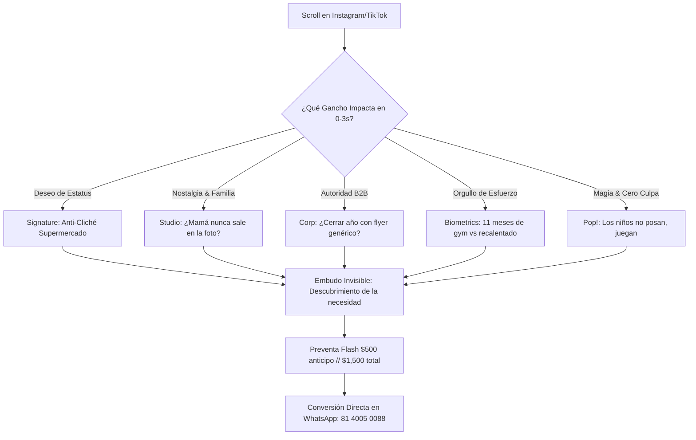

# MOTOR DE CONTENIDO VIRAL, GUIONES MULTIMARCA & MATRIZ GOOGLE SHEETS
## CAMPAÑA NAVIDAD 2026 · CAPTOORA STUDIO

*Documento Maestro Operativo para Producción Masiva en Canva Bulk Create, Google Sheets e Inteligencias Artificiales.*

---

## 🎯 PASO 1: LOS 5 GANCHOS VIRALES MAESTROS (EMBUDO INVISIBLE)

Para que un video o publicación detenga el scroll en los primeros 1.5 segundos, no vendemos "fotos navideñas con gorrito de Santa". Explotamos el deseo psicológico reprimido de cada segmento:

### 1. El Gancho "Anti-Cliché de Supermercado" (Captoora Signature)
- **Premisa Psicológica:** Las personas de alto poder adquisitivo rechazan lo cursi y lo masivo. Quieren verse como celebridades en gala privada, no como una postal barata de centro comercial.
- **Hook Verbal:** *"La Navidad no tiene que verse como un comercial de supermercado."*
- **Disparador:** Sofisticación, exclusividad, *quiet luxury*.

### 2. El Gancho de la "Madre Ausente en la Foto" (Captoora Studio)
- **Premisa Psicológica:** En el 90% de los hogares mexicanos, la mamá o el papá son quienes toman las fotos del celular. Al final del año, mamá tiene 3,000 fotos de sus hijos pero cero fotos de ella con su familia.
- **Hook Verbal:** *"¿Cuándo fue la última vez que toda tu familia estuvo en la misma foto y nadie salió con los ojos cerrados?"*
- **Disparador:** Validación del rol materno, alivio de culpa y atemporalidad familiar.

### 3. El Gancho de la "Vergüenza Corporativa" (Captoora Corp)
- **Premisa Psicológica:** Las empresas invierten millones en contratos y terminan el año felicitando a sus clientes clave con un meme o un diseño prefabricado de Canva. Eso proyecta falta de categoría empresarial.
- **Hook Verbal:** *"El 80% de las empresas cierran el año felicitando a sus clientes con un flyer genérico de Canva. Tu equipo ganó este 2026; demuéstralo con un retrato de alta dirección."*
- **Disparador:** Autoridad corporativa, retención de clientes y presencia en LinkedIn para Q1 2027.

### 4. El Gancho del "Registro de Disciplina" (Captoora Biometrics)
- **Premisa Psicológica:** Los atletas y entusiastas del gimnasio sacrificaron fiestas, comidas y entrenaron con frío. Quieren inmortalizar su pico físico antes de que lleguen los banquetes de diciembre.
- **Hook Verbal:** *"Entrenaste 11 meses con disciplina militar. Tu físico está en su mejor punto del año. No dejes que se quede en una selfie con el espejo sucio del gimnasio."*
- **Disparador:** Autoestima, recompensa personal y evidencia visual irrefutable.

### 5. El Gancho de "La Infancia que No Espera" (Captoora Pop!)
- **Premisa Psicológica:** Los papás tienen terror a las sesiones de fotos donde los niños lloran porque los obligan a quedarse tiesos y sonreír a la fuerza.
- **Hook Verbal:** *"Solo van a tener esta edad una sola Navidad en toda su vida. En Captoora Pop no los hacemos posar serios: los dejamos jugar y capturamos su risa real."*
- **Disparador:** Ternura, urgencia del tiempo y experiencia libre de estrés infantil.

---

## 🎬 PASO 2: LOS GUIONES TÉCNICOS AJUSTADOS (REELS 15s DE MONTAJE)

### GUION 01 · CAPTOORA SIGNATURE (Reel 15s)
- **Visual (0-3s):** Plano macro de copa de champagne chocando con destellos bokeh al fondo, revelando tela de terciopelo esmeralda sobre el set en montaje.
- **Texto en Pantalla:** `LA NAVIDAD NO TIENE QUE VERSE COMÚN`
- **Voz en Off (Locución):**
  > "La Navidad no tiene que verse como un comercial de supermercado. Si este año lograste lo que te propusiste, tu retrato debe lucir como portada de revista. Montando set de gala en San Jerónimo. Preventa abierta."
- **Visual (10-15s):** Ráfaga del sensor Nikon Z9 con luz de modelado y corte a la cápsula de WhatsApp.
- **CTA:** Aparta tu fecha privada con $500 MXN en WhatsApp al 81 4005 0088.

### GUION 02 · CAPTOORA STUDIO FAMILIAR (Reel 15s)
- **Visual (0-3s):** Mano acomodando un cojín bouclé crema y piñas nórdicas en el set. Un perrito entra al encuadre moviendo la cola.
- **Texto en Pantalla:** `¿QUIÉN TOMA LA FOTO EN TU CASA?`
- **Voz en Off (Locución):**
  > "¿Cuándo fue la última vez que toda tu familia estuvo en la misma foto y nadie salió con los ojos cerrados? En Captoora Studio los niños juegan y tu perrito también sale. Preventa familiar abierta."
- **Visual (10-15s):** Transición rápida al parque exterior verde afuera del estudio y texto de la preventa flash.
- **CTA:** Manda WhatsApp al 81 4005 0088 para congelar tu lugar en preventa de $1,500 MXN.

### GUION 03 · CAPTOORA CORP (Reel 15s)
- **Visual (0-3s):** Ajuste de corbata o puño sastre en cámara lenta, iluminado con recorte lateral de luz blanca fría y platino.
- **Texto en Pantalla:** `¿CÓMO VAS A CERRAR TU 2026?`
- **Voz en Off (Locución):**
  > "El 80% de las empresas cierran el año felicitando a sus clientes con un flyer genérico de Canva. Tu equipo ganó este 2026; demuéstralo con un retrato de alta dirección. Preventa corporativa activa."
- **Visual (10-15s):** Gráfico editorial con especificaciones in-company y WhatsApp visible.
- **CTA:** Solicita cotización corporativa con factura al 81 4005 0088.

### GUION 04 · CAPTOORA BIOMETRICS (Reel 15s)
- **Visual (0-3s):** Luz rim-light azul acero barriendo los dorsales de un atleta en contracción. Se escucha el bip de enfoque AF-C de la cámara.
- **Texto en Pantalla:** `TU DISCIPLINA MERECE QUEDAR REGISTRADA`
- **Voz en Off (Locución):**
  > "Entrenaste 11 meses con disciplina militar. Tu físico está en su mejor punto del año. No dejes que se quede en una selfie con el espejo sucio del gimnasio. Preventa abierta."
- **Visual (10-15s):** Visor con telemetría técnica (1/250s, f/1.2, ISO 64) y logotipo centrado.
- **CTA:** Escribe BIOMETRICS al 81 4005 0088 y separa con $500 MXN.

### GUION 05 · CAPTOORA POP! INFANTIL (Reel 15s)
- **Visual (0-3s):** Primer plano de una niña riéndose genuinamente mientras hace sonar un cascabel o abre una caja de regalo de madera.
- **Texto en Pantalla:** `SOLO TIENEN ESTA EDAD UNA VEZ`
- **Voz en Off (Locución):**
  > "Solo van a tener esta edad una sola Navidad en toda su vida. En Captoora Pop no los hacemos posar serios: los dejamos jugar y capturamos su risa real. Preventa navideña abierta con $500."
- **Visual (10-15s):** Destello festivo y botón de reserva inmediata.
- **CTA:** Reserva tu sesión infantil sin estrés en WhatsApp: 81 4005 0088.

---

## 📊 PASO 3: MATRIZ DE DATOS Y FLUJO GOOGLE SHEETS / CANVA BULK CREATE

### 📁 Archivo CSV Generado y Ubicaciones
- **Ruta en Repositorio:** `campaigns/campana-navidad-2026/CANVA_BULK_CREATE_NAVIDAD_2026.csv`
- **Acceso Directo en el Escritorio:** `/Users/imac/Desktop/CANVA_BULK_CREATE_NAVIDAD_2026.csv`

### 📋 Estructura de Columnas para Google Sheets & Canva
El archivo CSV cuenta con comillado estricto RFC 4180 y codificación UTF-8 con BOM para que abra automáticamente en Excel o se importe en Google Sheets sin romper acentos ni saltos de línea:

1. `ID_PIEZA`: Identificador único de control de producción.
2. `SUB_MARCA`: Submarca asignada (*Signature*, *Studio*, *Corp*, *Biometrics*, *Pop*).
3. `SEMANA_FASE`: Fase de la campaña (*Semana 1 · Preventa & Montaje*).
4. `DIA_PUBLICACION`: Día sugerido del calendario.
5. `FORMATO`: Reel 15s, Feed 4:5, Carrusel o Story.
6. `TITULAR_CANVA`: Titular con tipografía delgada y elegante.
7. `SUBTITULO_CANVA`: Bajada secundaria para el diseño.
8. `HOOK_VISUAL_0_3S`: Instrucción de rodaje para el creador.
9. `GUION_LOCUCION_AUDIO`: Guion de voz en off para grabación rápida.
10. `TEXTO_PANTALLA_OVERLAY`: Frase de alto impacto para stickers o edición de video.
11. `PLANTILLA_OVERLAY_RECOMENDADA`: Archivo PNG transparente exacto a utilizar.
12. `TELEFONO_CONTACTO`: Número ampliado de WhatsApp (`WhatsApp 81 4005 0088`).
13. `CAPTION_INSTAGRAM`: Texto persuasivo completo para copiar y pegar en redes.
14. `HASHTAGS`: Etiquetas optimizadas para alcance local en Monterrey.
15. `TRIGGER_PSICOLOGICO`: Gatillo emocional que sostiene la venta invisible.

---

## 🚀 CÓMO USAR ESTE CSV EN CANVA BULK CREATE (PASO A PASO)

1. **Abrir Canva en tu cuenta (CAPTOORA STUDIO):**
   - Entra al diseño base o crea un lienzo nuevo de **1080 x 1350 px** (Feed 4:5).
2. **Colocar la Plantilla Oficial Transparente v2:**
   - Arrastra el overlay transparente correspondiente (por ejemplo `OPCION_01_SIGNATURE_EDITORIAL_FONDO_OSCURO_4x5.png`) como capa superior.
3. **Activar Crear Varios (Bulk Create):**
   - En el menú lateral izquierdo de Canva, ve a **Apps** y busca **Crear varios** (*Bulk Create*).
   - Haz clic en **Subir archivo CSV** y selecciona `/Users/imac/Desktop/CANVA_BULK_CREATE_NAVIDAD_2026.csv`.
4. **Conectar los Datos:**
   - Haz clic derecho sobre el texto del Titular en Canva → **Conectar datos** → selecciona `TITULAR_CANVA`.
   - Haz clic derecho sobre el Subtítulo → **Conectar datos** → selecciona `SUBTITULO_CANVA`.
5. **Generar el Lote:**
   - Haz clic en **Continuar** y luego en **Generar páginas**.
   - En 5 segundos tendrás todas las piezas maquetadas de forma automatizada y listas para exportar o programar.
