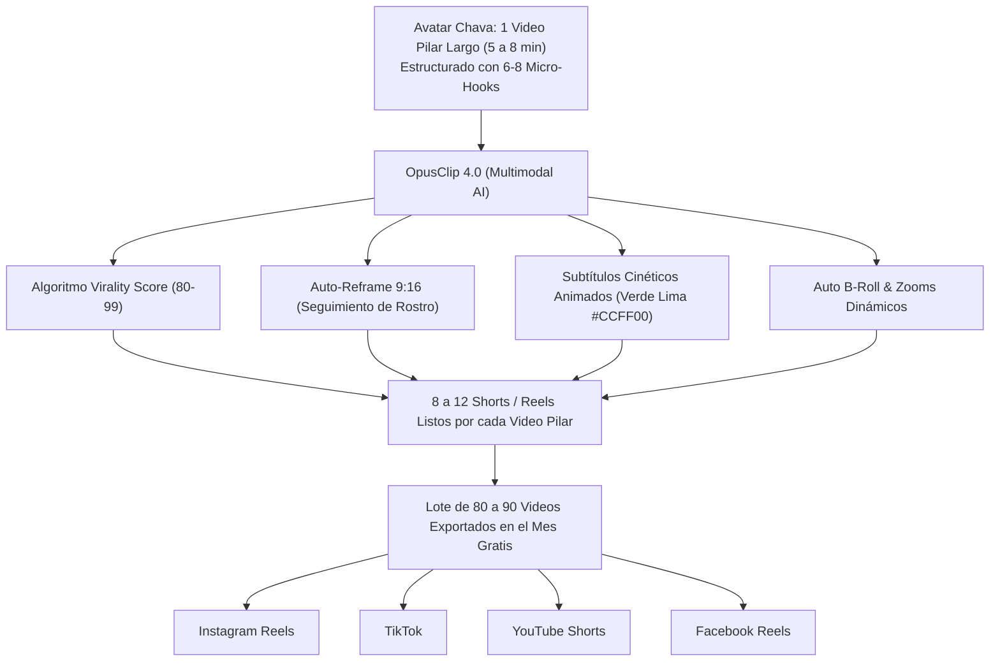

# PLAN MAESTRO: EXPLOTACIÓN OPUSCLIP 4.0 × AVATAR CHAVA
## CAPTOORA STUDIO · SPRINT 30 DÍAS DE CUOTA PROFESIONAL GRATUITA

*Estrategia industrial para transformar videos pilares del avatar Chava en 90 piezas virales de alto impacto (Reels, TikTok, YouTube Shorts) sin costo de suscripción.*

---

## 💎 LA REGLA DE ORO: EL EFECTO MULTIPLICADOR 1 → 10

En OpusClip, subir clips cortos de 20 segundos es un desperdicio de tiempo y créditos. La forma matemática y profesional de exprimir el plan Pro es el **Embudo de Video Pilar**:

Con solo grabar o generar **8 videos largos de Chava** (de 5 a 7 minutos cada uno), OpusClip 4.0 te entregará entre **70 y 90 videos cortos terminados** con cortes precisos, títulos gancho y subtítulos de estilo Hormozi/Beast.

---

## 🗓️ CRONOGRAMA DE 4 SEMANAS (CALENDARIO DE PRODUCCIÓN)

### SEMANA 1 (Días 1 a 7): SPRINT PREVENTA NAVIDEÑA FLASH
* **Objetivo:** Llenar los cupos de la temporada navideña en Colinas de San Jerónimo con la oferta de lanzamiento: **$500 de anticipo // $1,500 costo total** (antes de subir a $2,500).
* **Videos Pilares de Chava a subir (2 videos de 6 min):**
  1. *Pilar Navideño 01 (Familia & Niños):* Chava desglosando los 5 errores de tomar fotos navideñas con celular, por qué mamá nunca sale en la foto y cómo hacer que los niños no lloren.
  2. *Pilar Navideño 02 (Elegancia & Parejas):* Chava explicando por qué la gente con estilo busca fotos editoriales con copa de champagne y vestidos de gala en lugar de gorritos cursis de supermercado.
* **Rendimiento esperado:** **20 a 24 Reels navideños listos** para publicar 3 diarios durante el montaje de set.

### SEMANA 2 (Días 8 a 14): AUTORIDAD TÉCNICA & DIRECCIÓN FOTOGRÁFICA
* **Objetivo:** Destruir las objeciones típicas ("no sé posar", "salgo gordo en cámara", "no sé qué ponerme").
* **Videos Pilares de Chava a subir (2 videos de 6 min):**
  1. *Pilar Educación 01:* "Los secretos de la luz direccional que los fotógrafos no te dicen" (Luz Rembrandt, el truco de la mandíbula, colores que adelgazan en cámara).
  2. *Pilar Educación 02:* "Guía de vestuario para sesiones de estudio: combinaciones prohibidas y combinaciones ganadoras".
* **Rendimiento esperado:** **20 Reels educativos de alto guardado y compartidos.**

### SEMANA 3 (Días 15 a 21): B2B CORPORATIVO & BIOMETRICS (CIERRE 2026 / INICIO 2027)
* **Objetivo:** Vender paquetes de cierre de año para empresas y atraer a los atletas que quieren registrar su pico físico antes de Navidad.
* **Videos Pilares de Chava a subir (2 videos de 6 min):**
  1. *Pilar B2B:* "Tu foto de perfil de LinkedIn te está costando clientes para 2027: cómo proyectar autoridad de director general".
  2. *Pilar Biometrics:* "11 meses de disciplina militar en el gimnasio: por qué tu cuerpo merece un registro pericial con iluminación rim-light y sensor Nikon Z9".
* **Rendimiento esperado:** **20 Reels de alta conversión B2B y fitness.**

### SEMANA 4 (Días 22 a 30): BANCO DE RESERVA Q1 2027 (VACIADO DE CUOTA)
* **Objetivo:** Antes de que venza el día 30 del periodo gratuito, consumir el 100% de los minutos disponibles para dejar guardados en disco/nube los contenidos de **enero y febrero de 2027**.
* **Videos Pilares de Chava a subir (2 a 3 videos de 7 min):**
  1. Sesiones de cumpleaños y marca personal.
  2. Retratos de maternidad y recién nacidos.
  3. Contenido Evergreen de psicología de la imagen.
* **Rendimiento esperado:** **30 Reels adicionales archivados y programados.**

---

## 🎨 BRAND PRESET EN OPUSCLIP 4.0 (CONFIGURACIÓN EXACTA DE CAPTOORA)

Para que todos los clips salgan con la identidad estética de Captoora sin tener que retocarlos en CapCut:

1. **Brand Template en OpusClip:**
   - **Relación de aspecto:** 9:16 Vertical (1080 x 1920 px).
   - **Subtítulos (Captions):**
     - *Estilo:* 1 a 3 palabras por línea con salto dinámico (estilo *Karaoke Highlight*).
     - *Color de texto base:* Blanco Puro (`#FFFFFF`).
     - *Color de palabra resaltada (Highlight):* Verde Lima Captoora (`#CCFF00`) o Amarillo Dorado (`#FFD700`).
     - *Tipografía:* *Plus Jakarta Sans Bold*, *Montserrat* o *The Bold Font*.
     - *Sombra/Borde:* Trazo negro sutil para legibilidad sobre cualquier fondo.
   - **Auto B-Roll & Transiciones:** Activar auto B-roll contextualmente en 1.5x speed.
   - **Outro / Llamado a la acción:** Colocar cintillo inferior fijo: `WhatsApp: 81 4005 0088 · San Jerónimo, MTY`.

---

## 🛠️ CHECKLIST DE EJECUCIÓN INMEDIATA

1. **Paso 1:** Pasarme los videos de Chava que ya tienes listos.
2. **Paso 2:** Conectamos la cuenta Google de Jesús (`lic.jagf87@gmail.com`) en OpusClip 4.0 y creamos el Brand Template de Captoora.
3. **Paso 3:** Subimos el primer video pilar de Chava.
4. **Paso 4:** En 3 minutos OpusClip nos entrega los primeros 10 Reels rankeados con Virality Score 85+.
5. **Paso 5:** Seleccionamos los mejores, descargamos y publicamos el primer lote de preventa navideña.
