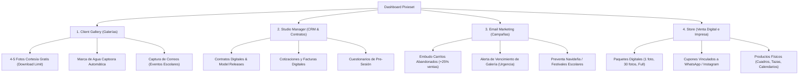

# Blueprint Maestro: Ecosistema Captoora.studio & Explotación Integral de Pixieset 2026

**Fecha de Creación:** 5 de Noviembre de 2026  
**Dominio Oficial Registrado:** `captoora.studio` (Registrador: Porkbun)  
**Plataforma de Galerías & CRM:** Pixieset (Plan Activo con Dominio Personalizado)  
**Subdominio de Galerías:** `galeria.captoora.studio`  
**Fundador & Director Creativo:** Alfonso GF (`@captoora.studio`)

---

## 1. El Poder del Dominio Propio (`captoora.studio`)

Al haber adquirido el dominio oficial, Captoora pasa de ser un proyecto informal a una **marca comercial registrada con autoridad digital**.

### A. Correos Corporativos Profesionales (Sin Pagar de Más)
* **Direcciones oficiales:**
  * `alfonso@captoora.studio` (Contacto directo y cotizaciones VIP)
  * `hola@captoora.studio` o `contacto@captoora.studio` (Atención general)
  * `galerias@captoora.studio` (Envío de accesos y notificaciones de entrega)
* **Estrategia de Costo $0 (Porkbun Email Forwarding):**
  * Porkbun incluye **redirección de correo gratuita e ilimitada**.
  * Todos los correos que envíen a `alfonso@captoora.studio` caen directo a tu bandeja personal de `alfonsogf.88@gmail.com`.
  * Se puede configurar en Gmail para "Enviar como" `alfonso@captoora.studio` usando los servidores SMTP de Porkbun o Google sin pagar los $140 MXN/mes de Google Workspace.

### B. Consolidación de Google Business Profile (Google Maps)
* **Verificación de Máxima Confianza:** Google penaliza perfiles con URLs temporales (como `.vercel.app` o enlaces de redes sociales). Al poner `https://captoora.studio` como sitio oficial, la verificación por video y la aprobación en Google Maps se aceleran drásticamente.
* **SEO Local en Monterrey:** Posicionamiento en búsquedas locales como *"estudio de fotografía en Barrio Antiguo"*, *"sesión de fotos Monterrey"*, *"fotografía de producto y moda MTY"*.

### C. Arquitectura de Subdominios Ilimitados
* `captoora.studio` ➡️ Sitio web principal de la marca (portfolio y presentación).
* `galeria.captoora.studio` ➡️ Plataforma de clientes en Pixieset.
* `link.captoora.studio` ➡️ Bio link para Instagram (reemplaza Linktree y mantiene el tráfico en tu propia marca).
* `navidad.captoora.studio` / `escuelas.captoora.studio` ➡️ Páginas de aterrizaje estacionales.

---

## 2. Explotación Máxima del Dashboard de Pixieset

Pixieset no es solo un visor de fotos; es un sistema operativo completo para estudios de fotografía. Al tener la suscripción de pago activa, se desbloquean 4 pilares fundamentales:

---

## 3. Client Gallery & El Embudo Viral de Redes Sociales

### A. Configuración de Colecciones para Clientas (Colaboraciones)
1. **Límite de Descargas de Cortesía:** Configurado a **4 o 5 descargas en alta resolución** por PIN o correo.
2. **Protección Anti-Robo:** Marca de agua oficial `CAPTOORA_SIGNATURE_LOGO.png` aplicada automáticamente sobre toda la galería en baja y media resolución.
3. **Tienda Activa en Cada Galería:**
   * **Foto individual extra:** Precio base con opción a descuento por cupón.
   * **Paquete de 30 fotos:** La clienta selecciona sus 30 favoritas directo con un clic.
   * **Galería completa:** Opción de compra total de la sesión.

### B. El Flujo de Cupones por Misión Social (WhatsApp Inbound)
1. En la galería de Pixieset se muestra el banner de colaboración.
2. La clienta toca el botón directo hacia WhatsApp:
   > *"¡Hola Captoora! Ya subí mi historia/publicación etiquetando a @captoora.studio. Aquí va mi captura de pantalla para mi cupón VIP 📸"*.
3. Respuesta con cupones creados en `Store > Coupons`:
   * `HISTORIA50` (50% en fotos individuales).
   * `PAQUETE30` (Precio preferencial en el bundle de 30 fotos).
   * `ALLIN-VIP` (Descuento exclusivo en la sesión completa).
4. La clienta aplica el cupón en la tienda de Pixieset, paga en línea y descarga de inmediato sus fotos en alta resolución sin marca de agua.

---

## 4. Studio Manager: Contratos Digitales & Liberación de Imagen (Model Releases)

> [!IMPORTANT]
> Para no tener problemas de derechos de autor ni reclamaciones de privacidad, toda clienta o colaboradora debe firmar su **Liberación de Imagen (Model Release)** antes o durante la entrega de su galería.

### A. Cómo usar los Contratos de Pixieset (`Studio Manager > Contracts`):
1. **Plantilla de Liberación de Imagen Comercial (Model Release):**
   * Estipula que Captoora Studio tiene autorización para publicar fotos en Instagram, portafolio web y Airbnb con fines promocionales.
   * La clienta recibe un enlace simple a su celular.
   * Firma con su dedo en la pantalla táctil de su teléfono en 30 segundos.
   * Queda registrado con validez legal, fecha, hora y dirección IP.
2. **Cuestionarios de Pre-Sesión (`Studio Manager > Questionnaires`):**
   * Preguntas sobre preferencias de vestuario, música favorita para la sesión, estilo visual que buscan y referencias estéticas.

---

## 5. Estrategia de Email Marketing: Escuelas y Festivales de Navidad

### A. El Caballo de Troya: Registro Obligatorio por Correo (`Email Registration`)
Para festivales navideños escolares, obras de teatro y eventos infantiles:
1. En Pixieset se sube el álbum del festival (ej. *Festival Navideño Colegio San Jerónimo 2026*).
2. Se activa la opción **"Email Registration Required"** (Requerir correo para ver las fotos).
3. **Resultado:** Ningún papá o mamá puede ver las fotos sin antes ingresar su nombre y correo.
4. **Base de Datos Automática:** En 24 horas obtienes 200 a 500 correos de padres de familia calificados de alto nivel socioeconómico de Monterrey.

### B. Campañas Automatizadas en Pixieset (`Email Marketing`):
1. **Campaña Early Bird (Preventa Navideña):**
   * Correo automático a los papás: *"Aprovecha 20% de descuento en impresiones y paquetes digitales antes del domingo"*.
2. **Campaña de Vencimiento (Urgencia):**
   * *"La galería del Festival Navideño se cerrará en 48 horas. Asegura las fotos de tus hijos aquí"*.
3. **Campaña de Carritos Abandonados:**
   * Si un papá seleccionó 5 fotos o un lienzo y cerró la ventana sin pagar, Pixieset le manda un correo automático 6 horas después: *"¿Olvidaste algo? Tus fotos te están esperando con envío directo a domicilio"*.

---

## 6. Integración Técnica & Migración desde Vercel

1. **Estado de Vercel:**
   * Si el sitio web principal estaba en Vercel, ahora se puede apuntar el dominio principal `captoora.studio` a Vercel (si se requiere un sitio personalizado en React/Next.js) o al **Website Builder de Pixieset** (para tener todo en una sola plataforma sin costo de servidores).
2. **DNS en Porkbun:**
   * `galeria.captoora.studio` ➡️ CNAME a `domain.pixieset.com` (Galerías y Tienda).
   * `@` (raíz) y `www` ➡️ Apuntados al sitio principal (Vercel o Pixieset Website).
   * Redirección de correo MX y TXT configurados para `alfonso@captoora.studio`.

---

## 7. Próximos Pasos Operativos Inmediatos

- [x] Compra del dominio oficial `captoora.studio` en Porkbun.
- [x] Activación de suscripción en Pixieset con soporte para dominio propio.
- [x] Exportación de logo oficial en alta resolución y Favicon a 32x32 px en Escritorio.
- [ ] Configuración del CNAME `galeria` en Porkbun y verificación en Pixieset.
- [ ] Creación de los 3 cupones de Instagram en la tienda de Pixieset.
- [ ] Activación de la plantilla de Contrato / Model Release en Pixieset Studio Manager.
- [ ] Actualización de la URL oficial en Google Business Profile a `https://captoora.studio`.
