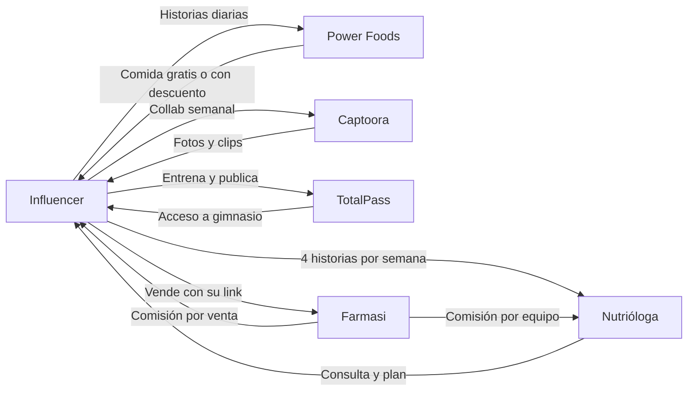

# Captoora Biogen 2027 · Modelo de Negocio "Alianza Quíntuple"

> **Idea central:** Enero es el mes en que todos empiezan: dieta, gimnasio y "ahora sí me voy a cuidar". Captoora captura ese momento y lo convierte en un programa donde **cada aliado gana**: el influencer recibe todo lo que necesita para transformarse a cambio de crear contenido, y cada negocio aparece en redes a través de los ojos de sus seguidores.

---

## 1. Los 5 aliados y qué gana cada uno

| Aliado | Qué aporta | Qué gana |
|---|---|---|
| **Captoora Studio** | Sesión fotográfica semanal de progreso + clips verticales; coordina todo el programa | Portafolio, visibilidad, clientes de paga (público general), y a futuro la **agencia de influencers** |
| **Nutrióloga Karen** (amiga de tu hermana, también distribuidora Farmasi) | Consulta en línea o presencial + plan alimenticio + **Ficha Nutricional** de cada influencer | Pacientes nuevos y difusión con la audiencia del influencer · **comisión Farmasi** por cada influencer que entre a su equipo · **imagen del programa** · **sesión profesional de su consultorio y retratos** |
| **Cocinas aliadas** (Power Foods como referencia; prioridad a **marcas nuevas que quieren crecer**) | Comidas del plan gratis o con descuento | Historias diarias con su marca → ventas · **fotografía profesional de platillos y local** para menú, apps de delivery y redes |
| **Gimnasio** (TotalPass o **red propia Captoora**, ver sección 6) | Acceso a entrenamiento | Contenido de transformaciones · **fotografía profesional de sus instalaciones** · socios nuevos |
| **Farmasi** (vía tu hermana y su directora) | Producto (proteína, creatina, preentreno, etc.) y modelo de afiliados | Más influencers en sus equipos = más ventas. Es justo lo que buscan |
| **Influencer** | Audiencia + contenido diario | Fotos profesionales, nutrióloga, comida, gimnasio **sin pagar** + **ingresos por comisiones Farmasi** |

> El influencer deja de "promocionar gratis": le pagan en especie por crear contenido y además gana dinero vendiendo.

### Captoora también le da algo a cada negocio: fotografía profesional
Además de lo que generan los influencers, Captoora entra a cada aliado con una **sesión profesional para su propio negocio**:
- **Cocinas:** fotografía de platillos (menú, Uber Eats / Rappi / DiDi, Instagram) y del local o la cocina.
- **Consultorio de Karen:** retratos profesionales, fotos del consultorio y de las consultas.
- **Gimnasios:** instalaciones, clases y coaches.

Así el aliado recibe valor desde el día 1, antes de que llegue la primera venta. Esto hace mucho más fácil que nos digan que sí.

### El influencer llega educado: Ficha Nutricional
Cada influencer llega con la cocina con una **Ficha Nutricional** que le hace Karen:
- Su plan (calorías, macros, porciones).
- Sus alergias e intolerancias.
- Los platillos del menú de la cocina que le toca comer.

La cocina sabe exactamente qué preparar, y el influencer sabe exactamente qué comer. Si come fuera de su plan, es decisión de él.

---

## 2. Cómo gana dinero cada parte (flujo)

**El "gancho" Farmasi es doble:**
1. El influencer gana comisión por lo que compren sus seguidores.
2. La nutrióloga gana por cada influencer que suma a su equipo → **ella tiene motivo propio para participar gratis** en las consultas.

---

## 3. Los dos carriles del programa

### Carril A · Influencers (canje + comisiones)
- Empezamos **con poquito**: cohorte de 4–6 influencers de 8K–25K seguidores.
- Cohorte inicial propuesta:

| Influencer | Seguidores aprox. | Estatus |
|---|---|---|
| El Médico Asesino | ~20K | Propuesta lista (PDF) |
| Leer Teniente* | 20K+ | Por contactar |
| Joel Isaí | 20K+ | Por contactar |
| Ángel Leal | 20K+ | Por contactar |
| Mauricio | ~8K | Por contactar |
| @soytrev2 | — | Ya colabora |

\* Confirmar nombre exacto y @ de cada uno.

- Cuando haya resultados medibles (Insights), escalamos a influencers grandes con un **plan ajustado a resultados**: más beneficios a quien más alcance y ventas genere.

### Carril B · Público general (de paga) — "Captoora Biogen Enero"
- Para quien no es influencer pero quiere registrar su transformación.
- Paquete 4 / 8 / 12 semanas: sesiones de progreso + consulta con la nutrióloga + descuento en comidas + suplementos Farmasi.
- Se vende con el mismo contenido que generan los influencers (prueba social).
- Puede ofrecerse como beneficio dentro de TotalPass.

---

## 4. Escalera de beneficios según resultados (influencers)

| Nivel | Seguidores | Qué recibe | Qué entrega |
|---|---|---|---|
| **Starter** | 5K–15K | 1 sesión cada 2 semanas, consulta, descuento en comida, alta en Farmasi | Historias diarias, collab quincenal |
| **Pro** | 15K–50K | Sesión semanal, consulta, comida gratis, gimnasio | Contrato completo actual (historias diarias, 4/sem nutrióloga, collab semanal, Insights) |
| **Elite** | 50K+ | Todo Pro + pago o bono por resultados | Metas de alcance y ventas medidas |

Subir de nivel depende de los **Insights reales** (alcance, ventas Farmasi con su link).

---

## 5. Gimnasios · Plan A TotalPass, Plan B red propia "Captoora Biogen Club"

**Plan A:** TotalPass se suma como gimnasio oficial (la presentación ya está lista).

**Plan B (y también complemento):** creamos **nuestra propia red de gimnasios aliados**.
- Muchos gimnasios y estudios quieren estar en TotalPass y **no los admiten**. Están buscando clientes y visibilidad.
- Les ofrecemos lo que TotalPass no da:
  - **Programas piloto de transformación** de 4, 8 o 12 semanas con fecha de arranque (enero), registro fotográfico, nutrióloga y comida. TotalPass da acceso al gym; nosotros damos **un programa con resultados visibles**.
  - Influencers entrenando en su gimnasio y publicándolo.
  - Sesión profesional de sus instalaciones.
  - Clientes de paga del carril B.
- A cambio: acceso gratis para los influencers + precio especial para los clientes Biogen.
- Mensaje para el público: *"TotalPass te da el gimnasio. Captoora Biogen te da el programa, la nutrióloga, la comida y las fotos que prueban tu cambio."*

---

## 6. Fase 2 · Agencia Captoora Talent

Cuando tengamos 8–10 influencers activos:
- Captoora se vuelve su **agencia**: los representa ante marcas, negocia campañas pagadas y cobra comisión (típicamente 15–20% de cada campaña).
- Los hacemos crecer: fotografía profesional semanal + estrategia de contenido + collabs cruzados entre los mismos influencers del roster.
- Ya contamos con la base: el contrato piloto, la skill de scouting y el portafolio.

---

## 7. Calendario rumbo a enero 2027

| Fecha | Acción |
|---|---|
| Semana del 18 nov | Llamada con la nutrióloga (WhatsApp) + hermana: confirmar participación y alta Farmasi |
| 25 nov | Propuesta a Power Foods MTY (y 2–3 cocinas alternas) |
| 25 nov – 5 dic | Presentación a TotalPass (PDF ya listo) |
| 1 – 15 dic | DMs y propuestas a la cohorte de influencers |
| 15 – 31 dic | Firmas, sesión base "Día 0" de cada influencer, contenido teaser |
| **2 ene 2027** | Lanzamiento: "Enero empieza aquí" — carril A y B activos |
| Feb – mar | Cortes de semana 4 y 8, reporte a aliados, apertura a influencers más grandes |

---

## 8. Pendientes de tu lado
1. @ de Instagram de Karen (solo tenemos su WhatsApp).
2. @ exactos de los influencers de la cohorte.
3. Confirmar con tu hermana el nombre de la directora Farmasi y cómo funciona la alta de nuevos miembros (costo de inscripción, si lo hay).
