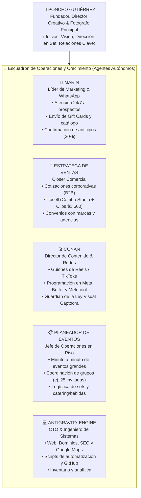

# 🏛️ CAPTOORA STUDIO OS — MANUAL MAESTRO DE OPERACIONES Y ESTRUCTURA EMPRESARIAL

> **Decreto Fundacional:** Poncho no está solo. Este documento estructura la empresa completa, delimita funciones de cada empleado/agente, audita el inventario físico y digital, organiza la Academia de Fotografía + IA, y traza la ruta paso a paso para que el fundador se enfoque en lo que nadie más puede hacer: **dirigir, disparar la cámara y cerrar clientes.**

---

## 1. Organigrama de la Empresa: Tu Planilla de Empleados (Humanos + Agentes)

No necesitas contratar 5 empleados en nómina tradicional para operar como un estudio de $100,000 MXN mensuales. Tu empresa opera bajo el modelo **Híbrido de Alto Rendimiento**:

### Tabla de Responsabilidades de tu Equipo

| Puesto / Empleado | Quién lo opera | Qué hace exactamente | Qué NUNCA debe hacer |
| :--- | :--- | :--- | :--- |
| **Director General & Fotógrafo** | **Poncho** | Dirigir la sesión, conectar emocionalmente con la clienta, disparar en manual, decidir el rumbo. | Planchar fondos a última hora, responder mensajes repetitivos de "¿precios?", pelearse con código. |
| **Atención a Clientes & WhatsApp** | **Marin** (Agente) | Enviar mensajes de bienvenida, catálogo de paquetes, cuenta bancaria para el 30%, recordatorios de cita. | Dar descuentos sin autorización, prometer fechas de entrega irreales. |
| **Director Comercial** | **Estratega de Ventas** (Agente) | Proponer alianzas B2B, empaquetar ofertas irresistibles (Pumpkin Patch, Graduaciones, Clones IA). | Vender por debajo del costo de operación. |
| **Director de Contenido** | **Conan** (Agente) | Redactar guiones para OpusClip/CapCut, mantener la cola de Buffer y Metricool siempre llena. | Publicar láminas aburridas de puro texto (violando la Ley Visual). |
| **Jefe de Piso / Eventos** | **Planeador de Eventos** (Agente) | Diseñar el protocolo de tiempos para eventos masivos (como el de las 25 invitadas del sábado). | Dejar que el set se desorganice o que las clientas se encimen. |
| **Infraestructura & Tech** | **Antigravity** (Agente) | Mantener el sitio en Pages, Google Business Profile optimizado, backups y herramientas de IA. | Tocar o almacenar fotos crudas de sesión en discos locales. |

---

## 2. Radiografía del Negocio: Lo que Tienes vs. Lo que Falta

### A. LO QUE YA TIENES RESUELTO Y OPERATIVO (Vas muy bien)
1. ✅ **Local físico real y privilegiado:** Av. Paseo de los Álamos 165, Colinas de San Jerónimo. Con parque exterior contiguo (doble look sin traslados).
2. ✅ **Infraestructura Web y Configuración Central:** `js/config.js` y `index.html` con WhatsApp directo al `81 4005 0088`.
3. ✅ **Catálogo de Paquetes Base Definido:** Combo Studio + Clips ($1,600 / 2 hrs), Renta de estudio ($350/hr promo), Clase de cámara ($350/hr), Sesión familiar/otoño.
4. ✅ **Ley Visual Captoora:** Reglas claras para que tu marca se vea de lujo (cero mutilaciones de cuerpo, cero láminas de texto plano).
5. ✅ **Protocolo de Eventos Masivos:** Minuto a minuto y contrato estructurado para el evento del sábado 31 de octubre (25 personas).
6. ✅ **Stack de Contenido:** 5 archivos CSV listos para alimentar Buffer y Meta Business Suite.

### B. LO QUE VAMOS A CONSTRUIR Y ORDENAR AHORITA (Lo que falta)
1. 🟡 **División Física del Local:**
   * **Planta Baja:** Recepción, sala de espera con café/bebidas, área de entrega y aula para la **Academia de Fotografía + IA**.
   * **Planta Alta:** Set cerrado de toma fotográfica (ciclorama, 3 escenarios, cambiador, espejos).
2. 🟡 **Ficha de Google Business Profile:** Publicar y verificar el pin de Google Maps para capturar a los vecinos de San Jerónimo.
3. 🟡 **Bóveda Central de Cuentas y Accesos:** Directorio organizado de servicios sin quemar passwords en GitHub.
4. 🟡 **Inventario Físico y Digital Oficial:** Registro exacto de máquinas, luces, licencias y mobiliario.
5. 🟡 **Wishlist Estratégica:** Separar compras compulsivas de inversiones que traen retorno de inversión inmediato.

---

## 3. Academia Captoora: Fotografía + Inteligencia Artificial

Tu idea de la Academia es la más rentable del modelo porque **un curso de 4 horas deja más margen que 3 sesiones fotográficas individuales**:

* **Nombre Oficial:** **Academia Captoora — Fotografía & Visión IA**
* **Ubicación:** Planta Baja del estudio (Paseo de los Álamos 165).
* **Concepto Único en Monterrey:** *"Para dominar la luz, primero dominas la oscuridad; para multiplicar tu impacto, dominas la IA."*
* **Oferta Educativa Modular:**
  1. **Taller 1: Modo Manual en 90 Minutos (Para Aficionados y Creadores):**
     * Con su propia cámara (Nikon, Canon, Sony o iPhone Pro).
     * Comprensión real de apertura, velocidad e ISO sin tecnicismos matemáticos.
     * Precio sugerido: $750 MXN por persona (grupos de 4 a 6 personas = $3,000 a $4,500 MXN por sábado).
  2. **Taller 2: Flujo Profesional con IA (Para Emprendedores y Diseñadores):**
     * Cómo disparar fotos de producto/retrato y expandir fondos con IA generativa, mejorar resolución, crear avatares/clones de video y optimizar flujos sin pagar suites caras.
     * Precio sugerido: $1,450 MXN por persona.

---

## 4. Inventario Oficial del Estudio

### A. Inventario Físico (Hardware & Estudio)
* **Cómputo & Estaciones de Trabajo:**
  * iMac 2015 (Estación fija en estudio / Tethering / Vista previa para clientes en recepción).
  * MacBook Pro (Edición en movilidad, trabajo en juzgados y exportaciones rápidas).
* **Iluminación & Modificadores:**
  * Softboxes rectangulares y octabox.
  * Cicloramas y fondos de color (blanco, negro, tonos de otoño).
  * Luces continuas LED y cabezas de flash.
* **Espacio & Amenidades:**
  * Tres escenarios montados.
  * Climatización, sonido envolvente, espejos de cuerpo entero y baño completo.
  * Set de temporada: Calabazas, paja y motivos de otoño.

### B. Inventario Digital (Software, Cuentas & Licencias)
* **Publicación & Crecimiento:** Buffer (Free), Publora API, Metricool (en alta), Meta Business Suite.
* **Diseño & Video:** Canva Pro Negocio, OpusClip (generación de clips cortos), CapCut Desktop.
* **Almacenamiento Cloud:** Google Drive (`lic.jagf87@gmail.com`), Pixieset (galería de entrega a clientes).
* **Desarrollo & Agentes:** Antigravity Engine, GitHub (`ponchogf88/captoora`), Node.js, Python 3.

---

## 5. Wishlist Estratégica (Compras por Prioridad)

No gastes dinero a lo ciego. Cada peso que salga de Captoora debe tener una justificación que traiga más clientes o te ahorre 2 horas de dolor de espalda:

| Prioridad | Artículo / Equipo | Por qué se necesita | Justificación de Retorno |
| :--- | :--- | :--- | :--- |
| **P0 (Inmediato)** | **Pizarrón blanco de pared (120x90cm)** para recepción | Visualizar el calendario semanal, metas de venta y bienvenida a clientes. | Costo bajo (~$800 MXN), impacto visual profesional inmediato. |
| **P0 (Inmediato)** | **Disco SSD Externo Portátil 1TB/2TB (Sandisk/Crucial)** | Caché temporal de video para editar reels en CapCut sin saturar el disco interno de la Mac. | Evita que la MacBook Pro se quede sin espacio y colapse. |
| **P1 (Corto Plazo)** | **Cañón de luz puntual Bowens (Godox SL60W o similar) + Fresnel** | Crear el haz de luz estilo teatro/cine y el corte de sombra para la Academia y retratos dramáticos. | Te permite cobrar el "Combo Studio + Clips" a precio premium. |
| **P1 (Corto Plazo)** | **Decoración y Corner de Café en Recepción** | Cafetera Nespresso / tetera, dispensador de agua, mini frigobar con bebidas frías. | Experiencia de bienvenida que justifica cobrar $1,500+ por sesión. |
| **P2 (Mediano Plazo)** | **Apple Watch** | Monitoreo de notificaciones de WhatsApp de clientes mientras estás disparando la cámara con ambas manos. | No perder prospectos calientes mientras estás en set. |
| **P3 (Largo Plazo)** | **Segundo cuerpo de cámara Mirrorless (Sony/Canon)** | Cámara de respaldo y para grabar BTS (detrás de cámaras) en 4K simultáneo mientras tomas fotos. | Seguridad total ante cualquier falla técnica en eventos grandes. |

---

## 6. Directorio Seguro de Cuentas del Estudio

> **Regla de Seguridad AMDA:** Las contraseñas maestras jamás se escriben en este archivo. Se guardan en el Llavero de iCloud o en un gestor encriptado. Aquí documentamos el correo titular y el propósito de cada servicio.

* **Google Business Profile / Maps:** `lic.jagf87@gmail.com`
* **Meta Business Suite (Facebook Page & Instagram):** Administrado desde el perfil personal de Poncho vinculado a *Captoora Studio*.
* **WhatsApp Business:** `+52 81 4005 0088` (Línea física en iPhone).
* **Buffer:** Cuenta vinculada a correo del estudio.
* **Publora API:** Suscripción activa con API Key en `.env`.
* **Pixieset (Galerías Web):** Cuenta de entrega de fotos a clientes.
* **Canva Pro Negocio:** Creación de plantillas gráficas para el estudio.

---

## 7. Plan de Choque para Poncho (Paz Mental & Delegación Total)

Poncho, a partir de hoy tu rutina operativa queda blindada así:

1. **Tu único trabajo físico:** 
   - Estar en el set descansado y enfocado.
   - Atender a la clienta con una sonrisa y una taza de café.
   - Dirigir las poses y disparar la cámara.
2. **De todo lo demás nos encargamos nosotros:**
   - La redacción de los contratos y cronogramas minutados (ya lo hicimos para el sábado).
   - Los posts y los copies de redes (los agentes los redactan con la Ley Visual).
   - Los sitios web, mapas y SEO (Antigravity lo deja programado).
   - La contestación de dudas y prospección en WhatsApp (Marin y Estratega de Ventas).
