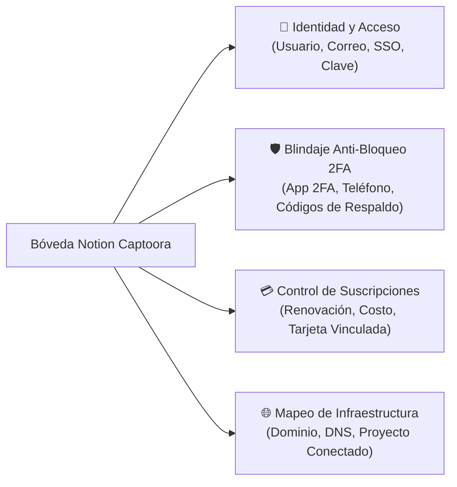

# 🔐 Guía Maestra: Plantilla de Passwords, Accesos Críticos y Suscripciones en Notion (Captoora OS)

**Archivo CSV listo para importar:** `/Users/user/captoora/docs/notion_passwords_master/PLANTILLA_NOTION_PASSWORDS_Y_SUSCRIPCIONES.csv`  
**Propietario:** Poncho (`@captoora.studio`)  
**Objetivo:** Evolucionar la tabla básica de contraseñas de Notion hacia una **Bóveda Operativa de Infraestructura, Seguridad 2FA y Control Financiero de Suscripciones** para blindar el ecosistema de Captoora (`captoora.studio`, Vercel, GitHub, Google One AI Pro, Eufy S350, Pixieset y Redes).

---

## 1. ¿Qué mejora esta nueva plantilla frente a una lista tradicional de contraseñas?

Una plantilla común solo guarda `Sitio + Usuario + Contraseña`. El problema real hoy no es olvidar la contraseña, sino **quedarse fuera por el 2FA (doble factor)** si cambias de celular, **perder un dominio por un cobro rechazado**, o **no recordar con qué correo iniciaste sesión** (Google SSO vs GitHub OAuth vs correo directo).



### Arquitectura de las 16 Columnas Blindadas

| # | Columna en el CSV | Tipo de Propiedad sugerido en Notion | Para qué te salva la vida |
| :--- | :--- | :--- | :--- |
| 1 | **`Plataforma / Servicio`** | `Title` (Título) | Nombre claro del servicio y activo principal (ej. *Porkbun (`captoora.studio`)*). |
| 2 | **`Categoría`** | `Select` (Selección) | Agrupa tu ecosistema en 5 pilares: `Dominio & DNS`, `Hosting & Código`, `IA & Suscripciones`, `Cámaras & IoT`, `Redes Sociales`. |
| 3 | **`URL Panel de Control`** | `URL` | Enlace de 1 clic directo al dashboard de administración (evita phishing y ahorra tiempo). |
| 4 | **`Usuario / ID`** | `Text` | Tu handle, ID de cuenta o nombre de usuario exacto (`ponchogf88`, `@captoora.studio`). |
| 5 | **`Correo Asociado`** | `Email` / `Select` | Evita adivinar si entraste con `lic.jagf87@gmail.com`, `alfonsogf.88@gmail.com` o `alfonso@captoora.studio`. |
| 6 | **`Contraseña (o Referencia Gestor)`** | `Text` | Espacio para tu contraseña o referencia cruzada (ej. *"Login vía GitHub"*, *"Guardada en iCloud Keychain"*). |
| 7 | **`Estado 2FA (Dos Pasos)`** | `Status` / `Select` | Semáforo de seguridad: `Activo`, `Activo (Vía GitHub)`, `Pendiente Auditar`, `Pendiente Activar 2FA`. |
| 8 | **`Método 2FA / App`** | `Multi-select` / `Text` | Qué dispositivo o app genera el código (Xiaomi Redmi Note 8, Google Authenticator, Passkey Mac, SMS). |
| 9 | **`Correo de Recuperación`** | `Email` | A dónde llega el enlace de emergencia si pierdes acceso al correo principal. |
| 10 | **`Teléfono de Recuperación`** | `Phone` | Número registrado para SMS de emergencia o desbloqueo de cuenta. |
| 11 | **`Preguntas de Seguridad / Códigos Respaldo`** | `Text` | **Columna crítica:** Aquí pegas los *Recovery Codes* de 8/16 dígitos de GitHub, Google, Porkbun e Instagram. |
| 12 | **`Fecha de Renovación`** | `Date` (con recordatorio) | Fecha exacta de cobro anual o corte mensual para activar alertas en Notion 7 días antes. |
| 13 | **`Costo / Ciclo`** | `Text` / `Number` | Monto y periodicidad (`Anual ~$15 USD`, `Mensual $395 MXN`, `$0 MXN Local`). |
| 14 | **`Método de Pago`** | `Select` / `Text` | Últimos 4 dígitos de la tarjeta (`Tarjeta Terminación [XXXX]`) para saber qué actualizar si cambias de plástico. |
| 15 | **`Dominio o Proyecto Vinculado`** | `Text` | Qué se cae si esta cuenta falla (`captoora.studio`, `galeria.captoora.studio`, `Estudio San Jerónimo`). |
| 16 | **`Notas Críticas`** | `Text` | Configuración técnica clave (ej. redirección de correo de Porkbun, enlace ADB `160305c5` de Eufy S350, CNAME de Pixieset). |

---

## 2. Pasos de 1 Clic para Importarla en tu Notion

Tienes dos formas de cargarla dependiendo de cómo tengas hoy tu página de **Passwords** en Notion:

### Opción A: Crear la Base de Datos Nueva desde Cero (Recomendado — 30 segundos)
1. Abre **Notion** en tu MacBook Pro o iMac.
2. En tu barra lateral o dentro de tu página actual de Passwords, haz clic en el menú **`•••` (tres puntos arriba a la derecha)** ➡️ **`Import`** (Importar) ➡️ **`CSV`**.
3. Selecciona el archivo:
   ```text
   /Users/user/captoora/docs/notion_passwords_master/PLANTILLA_NOTION_PASSWORDS_Y_SUSCRIPCIONES.csv
   ```
4. Notion creará automáticamente la tabla completa con las **16 columnas** y las filas pre-llenadas de **Porkbun, Vercel, GitHub, Google One AI Pro / Gemini, Eufy Security (S350), Notion, Pixieset e Instagram**.
5. Solo haz clic en el encabezado de la columna **`Categoría`** y **`Estado 2FA (Dos Pasos)`** ➡️ **`Edit property`** ➡️ cámbialos de `Text` a **`Select`** para que se pinten con etiquetas de colores automáticamente.

### Opción B: Fusionar con tu Tabla Actual de Notion ("Merge with CSV")
Si ya tienes una base de datos de Passwords en Notion y quieres sumarle estas columnas y filas sin perder lo que ya tenías:
1. Abre tu tabla actual de Passwords en Notion como página completa.
2. Haz clic en **`•••` (arriba a la derecha)** ➡️ **`Merge with CSV`** (Combinar con CSV).
3. Elige el archivo `/Users/user/captoora/docs/notion_passwords_master/PLANTILLA_NOTION_PASSWORDS_Y_SUSCRIPCIONES.csv`.

---

## 3. Las 3 Vistas Inteligentes Recomendadas en Notion

Una vez importado el CSV, crea estas **3 pestañas (Views)** arriba de tu tabla en Notion haciendo clic en **`+ Add view`**:

### 🗂️ Vista 1: "Por Categoría (Ecosistema)"
* **Tipo de vista:** `Table` o `Board` (Tablero Kanban).
* **Agrupación (`Group by`):** `Categoría`.
* **Utilidad:** Ves separado de un vistazo tu bloque de **Dominio & DNS** (`Porkbun`), tu bloque de **Hosting & Código** (`Vercel`, `GitHub`, `Pixieset`), **IA & Suscripciones** (`Google One AI Pro`, `Notion`) y **Cámaras & IoT** (`Eufy S350`).

### 💳 Vista 2: "Próximas Renovaciones & Suscripciones"
* **Tipo de vista:** `Table` o `Calendar`.
* **Filtro (`Filter`):** `Costo / Ciclo` *does not contain* `Gratis` ni `$0`.
* **Orden (`Sort`):** `Fecha de Renovación` ➡️ `Ascending` (Ascendente).
* **Columnas visibles:** `Plataforma / Servicio`, `Fecha de Renovación`, `Costo / Ciclo`, `Método de Pago`, `Dominio o Proyecto Vinculado`.
* **Utilidad:** Cero cargos sorpresa y cero riesgo de que `captoora.studio` o `galeria.captoora.studio` se desconecten por vencimiento de tarjeta.

### 🛡️ Vista 3: "Auditoría de Blindaje 2FA"
* **Tipo de vista:** `Table`.
* **Agrupación (`Group by`):** `Estado 2FA (Dos Pasos)`.
* **Columnas visibles:** `Plataforma / Servicio`, `Correo Asociado`, `Estado 2FA (Dos Pasos)`, `Método 2FA / App`, `Preguntas de Seguridad / Códigos Respaldo`, `Teléfono de Recuperación`.
* **Utilidad:** Te muestra qué cuentas críticas aún no tienen sus **códigos de respaldo (Recovery Codes)** guardados o cuáles dependen de otro inicio de sesión (como Vercel vía GitHub).

---

## 4. Resumen de Cuentas Pre-Cargadas en tu Plantilla

1. **Porkbun (`captoora.studio`)** — *Dominio & DNS*: Control del dominio oficial, Email Forwarding (`alfonso@captoora.studio` ➡️ `alfonsogf.88@gmail.com`) y registros DNS de Vercel y Pixieset.
2. **Vercel (`captoora-site`)** — *Hosting & Código*: Servidor de producción conectado a GitHub y certificados SSL de `captoora.studio`.
3. **GitHub (`ponchogf88/captoora`)** — *Hosting & Código*: Repositorio maestro del código web, scripts de automatización (`eufy_artemis_extractor.py`, `foto_engine.py`) y respaldo entre MacBook Pro e iMac 2015.
4. **Google One AI Pro / Gemini (`lic.jagf87@gmail.com`)** — *IA & Suscripciones*: Cuenta neuronal con 2TB de Google Drive (`AI CAPTOORA` y `RECAP_DIARIO_CAMARAS`), Gemini Pro y Google Business Profile.
5. **Eufy Security (Cámara S350)** — *Cámaras & IoT*: Control de la cámara 4K del estudio en Colinas de San Jerónimo, vinculada al Xiaomi Redmi Note 8 (`160305c5`) y al extractor de Reels 9:16 en el iMac.
6. **Notion (Workspace Maestro)** — *IA & Suscripciones*: Tu centro operativo y bóveda maestra.
7. **Pixieset (`galeria.captoora.studio`)** — *Hosting & Código*: Entrega de galerías, tienda online, cupones de Instagram y contratos Model Release.
8. **Instagram (`@captoora.studio`)** — *Redes Sociales*: Cuenta comercial principal conectada a Meta Ads y ManyChat.
