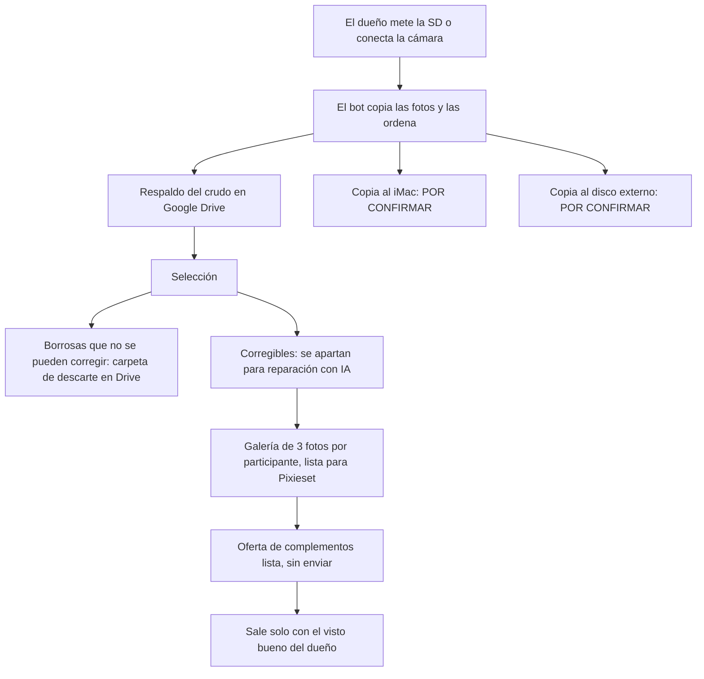

# Flujo del bot después de la captura

Procedimiento de la sesión Farmasi y de las que se trabajen igual. El bot prepara. El dueño decide qué sale. Nada llega a una participante sin su visto bueno: ni la galería, ni la oferta, ni un mensaje.

Las fotos de la sesión no entran a este repositorio. La [ley visual](../LEY_VISUAL_CAPTOORA.md) manda el camino del archivo: la SD es el origen, el crudo vive en Google Drive y la final vive en Pixieset.

## Diagrama

## 1. Arranque

El flujo empieza cuando el dueño mete la tarjeta SD o conecta la cámara. Antes de eso el bot no copia nada.

## 2. Copia y orden

El bot copia las fotos y las ordena. El criterio de carpetas (por participante, por hora o por número de archivo) queda [POR CONFIRMAR]. Mientras no exista la lista de nombres, no se etiquetan carpetas con nombres supuestos.

## 3. Respaldos

El dueño pidió tres respaldos: iMac, disco externo y Google Drive.

El respaldo que ya cabe en la ley visual es Google Drive: ahí queda el crudo. La misma ley prohíbe que las fotos de sesión toquen el disco interno, y nombra el iMac. También dice que la copia local de paso no se archiva en un disco duro. Por eso la copia al iMac y el archivo en el disco externo quedan [POR CONFIRMAR] hasta que el dueño los reconcilie con esa ley. El bot no los hace por su cuenta.

`CONTRATOS_POLITICAS_Y_TERMINOS.md` habla de resguardar el RAW 60 días. Este flujo no borra el crudo de Drive por calendario. Si ese plazo de 60 días sigue vigente para esta sesión, queda [POR CONFIRMAR].

Si una herramienta obliga a una copia local, esa copia es de paso. Se quita cuando el archivo ya está en la nube y el peso coincide. Quitar esa copia de paso no es borrar la toma.

## 4. Selección

El bot separa las tomas. No las tira.

El dueño dijo «borra» para las borrosas que no se pueden corregir. No se borran. La regla fija de Drive en `BITACORA_CAPTOORA_2026-10-18.md` dice «No borrar nada». `campaigns/operacion-contenido/REGLAS_PRODUCCION.md` dice «No borrar archivos por inferencia». Esas tomas se mueven a una carpeta de descarte dentro de Google Drive, junto al crudo. Ahí se quedan.

Si el dueño quiere esa carpeta en otro disco, queda [POR CONFIRMAR]. En el iMac no va.

Las que sí se pueden corregir se apartan para reparación con IA. Qué herramienta hace esa reparación queda [POR CONFIRMAR]. Evoto, en el [stack](stack-herramientas.md), está anotado para retoque, y este paso no lo da por hecho.

## 5. Galería de 3 fotos

Con lo seleccionado, el bot arma una galería de 3 fotos por participante, lista para Pixieset. Es la entrega de la colaboración, en galería privada. El nombre de la participante entra a Pixieset solo si ella autorizó, como dice la cláusula quinta del convenio.

La galería queda preparada. No se publica y no se manda el enlace.

## 6. Oferta de complementos

El bot deja lista la oferta de [complementos](../colaboracion/complementos.md) para que el dueño la envíe. Va solo a quien no es influencer destacada. Los precios siguen [POR CONFIRMAR], así que la oferta no se manda hasta que él confirme la cifra y dé el visto bueno.

## 7. Visto bueno

El dueño revisa galería y oferta. Con su visto bueno, se entrega la galería a quien ya publicó historia, mención, etiqueta y testimonio. El post de la participante va después de esa entrega. Sin su visto bueno no sale nada.
